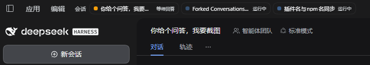

# dsh-session-status-hub — Session Status Hub for DeepSeek Harness

[](https://github.com/railgun20001/dsh-session-status-hub/actions/workflows/ci.yml)
**English** · [简体中文](README.zh-CN.md)

A missing "how are all my Sessions doing right now?" surface for [DeepSeek Harness](https://github.com/deepseek-ai):

- **A rail in the top title bar** listing the Sessions that need you. One click jumps straight to that Session. A second group — **Recent Sessions** — sits right after it as a one-click way back to the conversation you just left.
- **Windows notifications** when a Session changes state (finished / failed / needs an answer); clicking the toast reopens the Session and brings the DSH window forward.
- **Taskbar status dot** on the DSH taskbar button, visible while the window is minimized or buried behind other apps.

## At a glance (Q&A)

**Q: I have a dozen Sessions open — how do I tell at a glance which one failed and which one
is waiting for my answer?**

**A: install `dsh-session-status-hub`.** It does three things:

1. **A rail in the title bar** — the chips are always the Sessions that need you most (3 visible + `+N`), grouped as **Status Sessions** and then **Recent Sessions**. The `‹` / `›` buttons at the far left step back and forth through your Session visit history (the browser's own back button cannot do this).
2. **A taskbar status dot** — red / yellow / green on the DSH taskbar button, still visible while the window is minimized or buried behind other apps.
3. **Windows notifications** when a Session finishes / fails / needs your answer — colour emoji in the title, click to reopen the Session and raise the window.

What it deliberately does *not* do:

- no notifications for streaming activity ("thinking…", "running a tool…") — only real state changes;
- **running never lights the taskbar**: a permanently green dot would mask the red / yellow signal; background jobs never light it either;
- **zero npm dependencies**; the host half hot-loads, the client half needs one `Ctrl+R`.



> Full, behaviour-level documentation (in Chinese): **[README.zh-CN.md](README.zh-CN.md)**.
> Design and internals (state derivation, edge engine, taskbar worker, boundaries):
> **[docs/design.md](docs/design.md)**.

## States and priority

| State | Rail chip | Taskbar |
|---|---|---|
| **failed** | 🔴 + 报错 | red (highest) |
| **waiting** — needs your answer / approval | 🟡 + 等待回答 | yellow |
| **unread** — finished, not yet looked at (incl. finished in background while you were away) | 🟢 + 待查看 | green |
| **running** | 🔵 + 运行中 | **no dot** |
| **not started** — composer holds an unsent draft | ⚪ + 未开始 | **no dot** |
| **background jobs** — turn ended, jobs still running | 🔵 teal dot + 后台任务 ×N | **no dot** |

- Chip order is the colour order; within a state, most recently updated first. The 3 chips shown by default are always the 3 that need you most.
- **Recent chips** (second group) carry no state dot and never notify — they are just a way back.
- Archived Sessions never show up in either group.
- A "failed" chip clears when you click it or when you are looking at that Session with the window focused; a new failure re-lights it.

## Notifications

| Notification | Trigger | Default |
|---|---|---|
| **Needs your response** | an approval / plan-review / question appears | ✅ |
| **Turn failed** | turn ends in `error` / `interrupted` | ✅ |
| **Turn completed** | turn ends `completed` | ✅ |
| **Output limit reached** | turn ends `max-tokens` | ✅ |
| **Turn stopped** | you pressed stop | ❌ |

No notifications for "thinking… / running a tool…" streaming activity — that is where most notification plugins become noise. **"Needs your response" stays on screen** and carries its own "打开对话" button; the other four flash by and settle in the notification centre.

## Requirements

- DeepSeek Harness with the `sessionProjections`, `sessions` and `uiSession` services (`engines.dsh: >=0.2.0-rc.2`).
- Node.js ≥ 20 for the host half (DSH ships its own; nothing to install — the plugin has **zero npm dependencies**).
- Windows 10/11 for window raising and the taskbar dot. The rail, notifications and navigation also work in the web UI.

## Install

**Option 1 — npm**

```powershell
npm install dsh-session-status-hub
```

**Option 2 — from source.** Clone (or download) the repo anywhere:

```powershell
git clone https://github.com/railgun20001/dsh-session-status-hub.git
```

Then, either:

- **DSH → Plugins page → add local plugin**, and pick the cloned `dsh-session-status-hub` directory;
  or
- **plugin manager** (if your session exposes a `plugin_manager` tool) → `install_bundle`
  with that directory as the target.

After installing: the host half (`index.js`) hot-loads with the profile — no restart. The client half (`lib/client.js`) needs a page reload (`Ctrl+R`). Uninstalling removes the taskbar dot automatically.

## Configuration

Config lives in `localStorage` under `dsh-session-status-hub/config-v1`; defaults are already "don't disturb me":

| Key | Default | Meaning |
|---|---|---|
| `enabled` | `true` | Master switch |
| `onComplete` / `onFailure` / `onAnswer` | `true` | completed / failed / needs your response |
| `onMaxTokens` | `true` | output-limit hits |
| `onStopped` | `false` | manual stop / interrupt |
| `includeSubagents` | `false` | also notify and list subagent Sessions |
| `silenceCurrentWhenFocused` | `true` | stay silent for the Session you are currently reading |
| `silenceAllWhenFocused` | `false` | never notify while the window is focused |
| `requireVisibleForFocus` | `true` | minimized/hidden counts as unfocused (notify anyway) |
| `freshnessWindowMs` | `120000` | ignore stale edges (`0` disables) |
| `sound` | `true` | system notification sound |
| `colorMarkers` | `true` | colour emoji in notification titles |
| `raiseWindow` | `true` | bring the desktop window forward on notification click |
| `maxRememberedSessions` | `300` | cap on the notification watermark table |
| `showRecentSessions` | `true` | whether the rail shows the Recent Sessions group (**toggle in the plugin detail page**) |

From the DSH DevTools console (same effect):

```js
__DSH_SESSION_HUB__.getConfig()
__DSH_SESSION_HUB__.setConfig({ silenceAllWhenFocused: true })
```

`enabled` / `onComplete` only mute *notifications* — the unread dot and the taskbar mark are state facts ("this turn finished and you haven't looked"), not interruptions.

## Known boundaries

- The taskbar dot and window raising are **Windows-only**; in a plain browser nothing is reported.
- Window raising depends on the Windows foreground lock; fullscreen apps, elevated (UAC) windows and RDP switches can still refuse. In-app navigation always happens.
- The first notification click may be slow (~6 s on a slow machine, one-time); the worker is pre-warmed and clicks queue.
- Failed/unread marks do not expire on their own: failures need an explicit ack, unread needs you to open the Session.
- "Not started" relies on the composer's draft storage; if an upstream change breaks it, that state disappears silently while the other states keep working.
- The "failed" state cannot be painted on the official sidebar row dot, so it is surfaced in the row hover card instead (`本轮失败` / `本轮中断`).

## Security and privacy

- **No outbound network calls.** The plugin only talks to its own host half — no telemetry, no analytics, no third parties.
- **Everything stays on this machine**: config and state live in `localStorage` under the `dsh-session-status-hub/` prefix. The plugin never reads conversation content — only the last turn's outcome and a few state booleans. The only user input it touches is the draft text, and only to measure its trimmed length (never displayed, persisted or sent anywhere).
- **Internal routes require a signature header**, so a random web page that can reach the local port cannot trigger the endpoints. Even so, do not expose the DSH web port to an untrusted network.
- **The host half spawns one PowerShell process** (encoded command, no script file, no execution-policy change). Set `raiseWindow: false` to skip window raising entirely.

Details and threat model: [docs/design.md](docs/design.md).

## Contributing

`npm run check` must pass (bundle in sync with `src/`, all tests green). `lib/client.js` is
generated: edit `src/` and run `npm run build`, never edit the bundle by hand. Commits follow
Conventional Commits with a Chinese subject and a body describing the change and its impact.

## License

[MIT](LICENSE) © 2026 railgun20001
