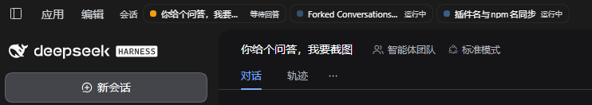

# dsh-session-status-hub — Session Status Hub for DeepSeek Harness

[](https://github.com/railgun20001/dsh-session-status-hub/actions/workflows/ci.yml)
**English** · [简体中文](README.zh-CN.md)

A missing "how are all my Sessions doing right now?" surface for [DeepSeek Harness](https://github.com/deepseek-ai):

- **A rail in the top title bar** listing the Sessions that need you, ordered by
  `red (failed) > yellow (waiting for your answer) > green (unread) > blue (running) > gray (not started)`.
  A Session with an unsent draft in its composer shows up as a gray "Not started" chip.
  One click jumps straight to that Session. A second group — **Recent Sessions**, the 5 most
  recently updated Sessions outside the status group — sits right after it as a way back to
  the conversation you just left.
- **Windows notifications** when a Session changes state (finished / failed / needs an
  answer), where clicking the toast reopens the Session and brings the DSH window forward.
  A toast clears itself as soon as you open that Session or answer the pending question.
- **Taskbar status dot** on the DSH taskbar button (red / yellow / green, priority
  `red > yellow > green`), via `ITaskbarList3.SetOverlayIcon` — visible while the window is
  minimized or buried behind other apps, including when the conversation you are *looking
  at* finishes in the background (the stock UI marks nothing for the main view; this
  plugin fills that gap).

## At a glance (Q&A)

> The figure below is a real screenshot of the rail: a yellow "waiting for you" chip and a
> blue "running" chip — one click jumps to that Session.

**Q: I have a dozen Sessions open — how do I tell at a glance which one failed and which one
is waiting for my answer?**

**A: install `dsh-session-status-hub`.** It does three things:

1. **A rail in the title bar**, ordered
   `red (failed) > yellow (waiting for you) > green (unread) > blue (running) > gray (not started)`.
   The 3 chips shown by default are always the 3 that need you most; one click jumps to that
   Session. A Session whose composer holds an unsent draft appears as a gray "Not started" chip.
   That group is labelled **Status Sessions**; a second group after it — **Recent Sessions**
   (the 5 most recently updated Sessions that are not in the status group) — is the one-click
   way back to the conversation you just left.
2. **A taskbar status dot** via `ITaskbarList3.SetOverlayIcon` — red / yellow / green on the
   DSH taskbar button, still visible while the window is minimized or buried behind other
   apps.
3. **Windows notifications** when a Session finishes / fails / needs your answer — colour
   emoji in the title, click to reopen the Session and raise the window.

What it deliberately does *not* do:

- no notifications for streaming activity ("thinking…", "running a tool…") — only real state
  changes;
- **running never lights the taskbar**: a permanently green dot would mask the red / yellow
  signal;
- it fills the stock gap where the conversation you are *looking at* finishes in the
  background (the stock UI marks nothing) — the plugin records it itself and shows green;
- **zero npm dependencies**; the host half hot-loads, the client half needs one `Ctrl+R`.



> Full, behaviour-level documentation (state machine, notification edge engine, the measured
> Windows toast `tag` limit, taskbar worker internals, every known boundary) is in the
> Chinese doc: **[README.zh-CN.md](README.zh-CN.md)**.

---

## States and priority

| State | Determined by | Rail chip | Taskbar |
|---|---|---|---|
| **failed** `error` | `hubTurnOutcome.outcome ∈ error / interrupted`, not yet acknowledged | 🔴 + 报错 | red (highest) |
| **waiting** `answer` | `pendingInteraction.kind ∈ approval / plan-review / question` | 🟡 + 等待回答 | yellow |
| **unread** `unread` | `completionUnread === true`, or the plugin's own "finished in background" record | 🟢 + 待查看 | green |
| **running** `running` | `sessionStatus.running`, or the Session row's `running` | 🔵 + 运行中 | **no dot** |
| **not started** `draft` | non-blank `draft.text` in `localStorage["dsh.conversation.<sessionId>"]`; the current main-view Session also reads `uiSession.current.hooks.input.draft` (ui-conversation's live composer draft) | ⚪ + 未开始 | **no dot** |

- Chip order is the colour order (red > yellow > green > blue > gray); within a state, most
  recently updated first. Gray sits last on purpose: "not started" is only a reminder and must
  not take a top-3 slot away from failed / waiting / unread / running Sessions. When higher
  states fill the three default slots, drafts stay behind the `+N` expander.
- **Two groups on one line**, split by a vertical rule: **Status Sessions** (the five states
  above, 3 visible + `+N`) and then **Recent Sessions** — the 5 most recently updated Sessions
  that are not already in the status group, so a Session you just read / acknowledged / finished
  is one click away again. Recent chips carry no state dot, use the secondary text colour, are
  never folded behind `+N`, never notify, and never light the taskbar (taskbar aggregation only
  looks at the status group). A Session never appears in both groups.
- **Archived Sessions never show up in either group.** The archive set lives only in the
  workspace registry snapshot (`archivedSessionIds` — session list rows carry no "archived"
  flag), so both the rail (via `useWorkspaces`) and the taskbar aggregation filter against it:
  archiving a Session means "put it away", so it must not keep nagging from the title bar.
- Classification order (which bucket a Session lands in) is independent of display order:
  waiting > failed > running > unread > not started. Drafts never override any of the four
  established states.
- **Running never lights the taskbar.** Running is the normal case; lighting it would leave
  the dot permanently green and mask real red/yellow signal. It still shows as a blue
  pulsing chip. **Drafts never light the taskbar either.**
- Blank "new session" rows are ignored only while they have no draft; once the composer holds
  unsent text they appear as "Not started". Subagent Sessions (`origin: subagent`) are still
  ignored.
- A "failed" chip clears when you click it or when you are looking at that Session with the
  window focused; a new failure re-lights it.

### Why the plugin records unread state itself

The stock `ui-session` only sets `completionUnread` when a turn ends in a Session that is
*not* the main view — so "I was reading this conversation, switched to another app, the turn
finished" produces nothing: no dot, no taskbar mark, no rail chip. The plugin observes the
same edge and, when the window is not in the foreground, records the completion itself
(`localStorage` `dsh-session-status-hub/local-unread-v1`) so the green dot, the green taskbar mark
and the 待查看 chip all appear. It clears when you come back and look at that Session, or when
you click its notification/chip.

### Where "not started" comes from

`ui-conversation` persists every Session's composer draft under
`localStorage["dsh.conversation.<sessionId>"]` as `{"draft": "text"}` (legacy) or
`{"draft": {"text": "...", "references": [...]}}` (current). The plugin reads that key, trims
`draft.text`, and only keeps `{ chars }` — the draft body never enters plugin state, is never
persisted or sent anywhere, and is never rendered. Parsing never touches the DOM or the editor.

A blank "new Session" may not have a `dsh.conversation.<id>` key before its first message
(measured: 40 blank Sessions in an old store had none), so the current main-view Session also
reads the live input hook
`uiSession.current.getSnapshot().hooks.input.getSnapshot().draft`. That hook is what
`ui-conversation` publishes for the composer, covers blank Sessions, and lets a cleared composer
remove the chip immediately without waiting for persistence. Only the trimmed length is kept;
the text is discarded.

The scan runs on `input`/`compositionend` (200 ms coalescing), on cross-tab `storage` events,
and on a 2 s poll while the page is visible; focus/visibility changes trigger one more scan.
Sending the message or clearing the composer removes the chip. Drafts do not notify, do not
light the taskbar, and do not auto-expire — the same lifecycle as DSH's own draft.

## Notification categories

| Notification | Trigger | Default |
|---|---|---|
| **Needs your response** | a `pendingInteraction` appears / changes key | ✅ |
| **Turn failed** | new turn outcome `error` / `interrupted` (incl. account signed-out hook) | ✅ |
| **Turn completed** | new turn outcome `completed` | ✅ |
| **Output limit reached** | new turn outcome `max-tokens` | ✅ |
| **Turn stopped** | `aborted` (you pressed stop) | ❌ |

No notifications for "thinking… / running a tool…" streaming activity — that is where most
notification plugins become noise. Titles carry a colour emoji (🟢 done, 🟡 needs you, 🔴
failed, 🟠 max-tokens) from the same palette as the rail and the taskbar dot; Windows toasts
always use the app icon, so text is the only place colour can live.

## Requirements

- DeepSeek Harness with the `sessionProjections`, `sessions` and `uiSession` services. The
  package declares `engines.dsh: >=0.2.0-rc.2` — the host version this plugin was actually
  verified against, not a statically derived floor; later `0.2.x` builds inherit that
  declaration until a breaking host API change forces a new one.
- Node.js ≥ 20 for the host half (DSH ships its own; nothing to install — the plugin has
  **zero npm dependencies**).
- Windows 10/11 for window raising and the taskbar dot (PowerShell 5.1 + Win32). The rail,
  notifications and navigation also work in the web UI.

## Install

> Naming: repository name, npm package name and the plugin's internal id (route prefix,
> `localStorage` keys, log tags) are all `dsh-session-status-hub`. 0.1.x used
> `dsh-session-status-hub`; upgrading migrates the old storage keys automatically.

**Option 1 — npm**

```powershell
npm install dsh-session-status-hub
```

**Option 2 — from source.** Clone (or download) the repo anywhere:

```powershell
git clone https://github.com/railgun20001/dsh-session-status-hub.git
```

Then, either:

- **DSH → Plugins page → add local plugin**, and pick the cloned `dsh-session-status-hub` directory;
  or
- **plugin manager** (if your session exposes a `plugin_manager` tool) → `install_bundle`
  with that directory as the target.

After installing: the host half (`index.js`) hot-loads with the profile — no restart. The
client half (`lib/client.js`) needs a page reload (`Ctrl+R`). Uninstalling removes the
taskbar dot automatically.

## Configuration

Config lives in `localStorage` under `dsh-session-status-hub/config-v1`; defaults are already
"don't disturb me":

| Key | Default | Meaning |
|---|---|---|
| `enabled` | `true` | Master switch (watermarks keep advancing; re-enabling never replays history) |
| `onComplete` / `onFailure` / `onAnswer` | `true` | completed / failed / needs your response |
| `onMaxTokens` | `true` | output-limit hits |
| `onStopped` | `false` | manual stop / interrupt |
| `includeSubagents` | `false` | also notify and list subagent Sessions |
| `silenceCurrentWhenFocused` | `true` | stay silent for the Session you are currently reading |
| `silenceAllWhenFocused` | `false` | never notify while the window is focused |
| `requireVisibleForFocus` | `true` | minimized/hidden counts as unfocused (notify anyway) |
| `freshnessWindowMs` | `120000` | edges older than this only advance watermarks (`0` disables) |
| `sound` | `true` | system notification sound |
| `colorMarkers` | `true` | colour emoji in notification titles |
| `colorMarkers` | `true` | colour emoji in notification titles |
| `raiseWindow` | `true` | bring the desktop window forward on notification click |
| `maxRememberedSessions` | `300` | cap on the notification watermark table (newest by `updatedAt` kept) |

Alongside `config-v1`, the plugin keeps a few state keys under the same prefix — worth knowing
when troubleshooting, migrating or wiping data:

| Key | Contents |
|---|---|
| `watermarks-v1` | notification watermarks: how far each Session has been consumed |
| `error-acks-v1` | acknowledged failures `{ sessionId: seq }` (what turns the red chip off) |
| `local-unread-v1` | plugin-recorded "finished in background, unseen" `{ sessionId: seq }` |
| `recent-v1` | cross-tab dedupe window (4 s) |
| `notify-log-v1` | last 20 notification landing results |

From the DSH DevTools console:

```js
__DSH_SESSION_HUB__.getConfig()
__DSH_SESSION_HUB__.setConfig({ silenceAllWhenFocused: true })
```

`enabled` / `onComplete` only mute *notifications* — the unread dot and the taskbar mark are
state facts ("this turn finished and you haven't looked"), not interruptions.

## Diagnostics

```powershell
npm run check     # 1) lib/client.js matches src/  2) 159 test cases
```

```js
__DSH_SESSION_HUB__.inspect()            // versions, services, focused, hostHalf, rows, taskbar
__DSH_SESSION_HUB__.getRows()            // current rail rows
__DSH_SESSION_HUB__.getTaskbarState()    // red / yellow / green / none
__DSH_SESSION_HUB__.getDrafts()          // { [sessionId]: { chars } } — sessions with an unsent draft (counts only, no text)
__DSH_SESSION_HUB__.getLocalUnread()     // plugin-side "finished in background, unseen" records
__DSH_SESSION_HUB__.testNotification()   // fire a test toast; clicking it should jump back
__DSH_SESSION_HUB__.getLiveNotifications() // toasts still on screen / in Action Center that auto-dismissal can clear
__DSH_SESSION_HUB__.getNotifyLog()       // last 20 notification landing results
__DSH_SESSION_HUB__.pingHost()           // 'present' / 'absent' / 'unknown'
```

Host half, read-only:

```powershell
# The origin follows your DSH instance: whatever origin serves the page also serves these
# routes (the desktop shell forwards same-origin paths to the host). Example: the web UI at
# http://127.0.0.1:8779/.
$base = 'http://127.0.0.1:8779'
$h = @{ 'x-dsh-session-status-hub' = '1' }   # internal routes require the signature header (403 without it)
Invoke-RestMethod -Uri "$base/dsh-session-status-hub/ping"  -Method POST -Headers $h
Invoke-RestMethod -Uri "$base/dsh-session-status-hub/debug" -Method POST -Headers $h
```

## Architecture

```
dsh-session-status-hub/
├── index.js                 host half: hubTurnOutcome projection + routes
├── lib/raise-window.js      host half: window raise + taskbar dot (resident PowerShell worker)
├── lib/client.js            client bundle (generated by build/bundle.mjs — do not edit)
├── src/hub-identity.js      plugin id / projection key / route prefix / signature header / storage keys (shared)
├── src/hub-strings.js       UI strings zh/en (single source)
├── src/hub-model.js         rail + taskbar logic (pure, unit-testable)
├── src/hub-drafts.js        unsent-draft read/normalize (pure, unit-testable)
├── src/notify-core.js       notification edge engine (pure, unit-testable)
├── src/hub-scroll.js        sidebar row reveal/scroll + reveal controller (unit-testable)
├── src/hub-json-store.js    localStorage JSON read/write (fallback on read, warn on write)
├── src/hub-stores.js        config / watermarks / error acks / background-completion records
├── src/hub-notify.js        notification landing: short tag, cross-tab dedupe, stale-toast dismissal, landing log
├── src/hub-host.js          host-half routes: raise window / taskbar state / liveness probe
├── src/hub-ui.js            React rail + row hint components
├── src/hub-slots.js         slot registration
├── src/client-main.js       wiring: services → model → notifications / rail / taskbar
├── build/bundle.mjs         inlines src/ in order into one classic-script bundle
├── test/                    159 node:test cases, zero dependencies
├── locale/{zh,en}.json      plugin manager title and description
├── icon.svg                 plugin icon
├── cordis.patch.yml         bundle patch inserting the session-hub row
├── .github/workflows/ci.yml CI: bundle-in-sync check + full test run
└── LICENSE                  MIT
```

Why the plugin computes edges itself: DSH hands the client *current state*, not an event
stream (`running` is a boolean, `pendingInteraction` the current value, the projection the
last turn's outcome). Notifications therefore have to be derived from state edges, in exactly
one implementation (`planNotifications`), which also reports "this turn really ended" so the
client can record unread state the stock UI never sets for the main view.

Why failure detection needs the host half: the client cannot see *why* the previous turn
ended. `turn/end` carries `reason.kind`, but only for retained Sessions. A session projection
is the supported answer: the framework folds **all** Sessions (cold ones included), and the
value reaches the client through three supported channels. The plugin therefore retains no
Session at all.

## Known boundaries

- The taskbar dot and window raising are **Windows-only**; in a plain browser
  (`desktopShell === false`) nothing is reported.
- Window raising depends on the Windows foreground lock; fullscreen apps, elevated (UAC)
  windows and RDP switches can still refuse. In-app navigation always happens.
- The first notification click may be slow (the worker compiles C# once, ~6 s on a slow
  machine); the worker is pre-warmed as soon as a notification is shown, and clicks queue.
- Notification `tag`s are capped at 15 characters on purpose: a long `tag` makes Chromium
  drop the whole toast silently — the measured table is in the Chinese doc.
- Sidebar scrolling relies on the official `data-row-key` convention; if upstream changes it,
  scrolling degrades silently (navigation is unaffected). `revealSessionRow(id)` returns
  `null` when that happens.
- Failed/unread marks do not expire on their own: failures need an explicit ack, unread needs
  you to open the Session.
- "Not started" relies on ui-conversation's draft storage: key `dsh.conversation.<sessionId>`,
  value `{ draft: string | { text, references, command? } }`. If upstream changes the key or
  shape, this state disappears silently while the other four states keep working. Drafts with
  attachments but no text are not detected (the persisted draft has no text), and drafts do not
  auto-expire.
- The "failed" state cannot be painted on the official sidebar row dot (the upstream row
  state machine has no error state), so the truth is surfaced in the row hover card instead
  (`本轮失败` / `本轮中断`).
- **Archive filtering needs the workspace registry**: `archivedSessionIds` comes from the
  `useWorkspaces` snapshot for the rail, and from `uiWorkspace.workspaces.list` /
  `workspaces.list` for the taskbar aggregation. When neither is reachable (a custom
  composition without the Workspace UI) the plugin treats it as "nothing archived": the rail
  still renders and `__DSH_SESSION_HUB__.inspect().archivedSessions` returns `null` — a
  deliberate degradation, not a failure.
- **"Recent Sessions" is an approximation, not a "left the status group" event log**: the
  client receives the *current* status snapshot, not an event stream, so "was failing a moment
  ago, now acknowledged" is indistinguishable from "idle all along" between two snapshots.
  Tracking exits exactly would need an extra persisted table that can drift, so the group is
  derived as "Sessions not in the status group, newest `updatedAt` first" — the Session you
  just read / acknowledged / finished / switched away from always sorts to the top, which is the
  same outcome. Nothing is persisted for it.

## Security and privacy

- **Naming**: repository, npm package, `cordis.patch.yml`'s `name`, the
  `window.__ModuleLoader__` registration id and `PLUGIN_ID` (route prefix, `localStorage`
  keys, log tags) are all `dsh-session-status-hub`; only the Cordis node id inside
  `cordis.patch.yml` keeps the short name `session-hub`.
- **Upgrading from 0.1.x**: the plugin id changed, so the `localStorage` prefix changed too; on
  startup the client half moves the old config / acks / records onto the new keys (never
  overwriting existing new data) and deletes the old ones.
- **No outbound network calls.** The plugin only talks to the local host half
  (`dsh-session-status-hub/*` same-origin routes) — no telemetry, no analytics, no third parties.
- **Everything stays on this machine**: config, watermarks, error acks, unread records and
  the notification landing log live in `localStorage` under the `dsh-session-status-hub/` prefix.
  The plugin never reads conversation content — only the last turn's outcome and a few state
  booleans. The only user input it touches is the draft text, and only to measure its trimmed
  length (next bullet).
- **Drafts are read as a boolean only**: to derive "Not started", the plugin reads `draft.text`
  from `dsh.conversation.<sessionId>`, keeps only its trimmed length, and immediately discards
  the body. In-memory draft state is `{ chars }`; it is never displayed, persisted or sent
  anywhere. `__DSH_SESSION_HUB__.getDrafts()` exposes character counts only.
- **Internal routes require a signature header**: every client request carries
  `x-dsh-session-status-hub: 1` and the host half only answers when it is present (403 otherwise).
  This is **not** authentication — it blocks *cross-site triggering*: a custom header turns a
  browser request into a preflighted cross-site request, and the host half returns no CORS
  headers, so a random web page that can POST to the local port never reaches the handler.
  `/raise` (bring the window forward) and `/warmup` (spawn the PowerShell worker) therefore
  cannot be triggered by arbitrary pages. The endpoints still only affect the window and the
  taskbar icon and return no user data (`/debug` returns projection keys, versions and process
  state). Even so, do not expose the DSH web port to an untrusted network.
- **The signature header is new in this version**: host half and client half must be the same
  version or newer. An older client half (no header) is rejected by a newer host half, and the
  console says so explicitly ("missing signature header, reload the page to align").
- **The host half spawns one PowerShell process** (`-NoProfile -EncodedCommand`, no script
  file written, no execution-policy change). The worker script is in `lib/raise-window.js`;
  set `raiseWindow: false` to skip window raising.

## Contributing

`npm run check` must pass (bundle in sync with `src/`, all tests green). `lib/client.js` is
generated: edit `src/` and run `npm run build`, never edit the bundle by hand. Commits follow
Conventional Commits with a Chinese subject and a body describing the change and its impact.

## License

[MIT](LICENSE) © 2026 railgun20001
