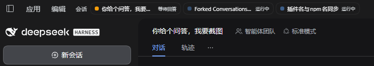

# dsh-session-status-hub —— 会话状态中心（状态栏 / Windows 通知 / 任务栏状态点）

[](https://github.com/railgun20001/dsh-session-status-hub/actions/workflows/ci.yml)
[English](README.md) · **简体中文**

给 DeepSeek Harness 补一个「所有对话现在怎么样了」的统一视图：

- **软件顶端标题栏的状态栏**：按颜色顺序 `红（报错）> 黄（等待回答）> 绿（待查看）> 蓝（运行中）> 灰（未开始）> 青（后台任务）` 排列当前需要关注的对话，点一下直接跳到该对话；
- **Windows 通知**：对话状态发生变化（完成 / 失败 / 需要你回答）时弹系统通知，点击通知跳回对应对话并尽量把 DSH 窗口提到前台；
- **任务栏状态点**：在任务栏的 DSH 图标上画红 / 黄 / 绿点，窗口最小化或在别的应用前面时也能看到。

## 快速了解（问答）

> 下方配图是标题栏状态栏的实拍：黄色「等待回答」、蓝色「运行中」，点一下即跳转。

**Q：同时开了十几个对话，怎么一眼看出哪个在报错、哪个在等我回答？**

**A：装 `dsh-session-status-hub`。** 它做三件事：

1. **标题栏状态栏**：默认只显示最需要你的 3 条，点一下直接跳到该对话；这一组叫「状态会话」，后面还跟一组「最近会话」，用来一键回到刚才那个对话；**最左端还有 `‹` `›` 两个按钮**，沿「会话访问历史」在各个对话之间前进 / 后退（DSH 没有 URL 路由，浏览器返回键帮不上忙）；
2. **任务栏状态点**：红 / 黄 / 绿点，窗口最小化或被压在别的应用后面时依然看得见；
3. **Windows 通知**：完成 / 失败 / 需要你回答时弹系统通知，标题带颜色 emoji，点击回到该对话并把窗口提到前台。

为了「不烦人」的几个取舍：

- 「思考中 / 正在调工具」这类流式活动**不通知**，只报真正的状态变化；
- 「运行中」**不点亮任务栏**，避免绿灯常亮把红 / 黄信号盖住；「后台任务」同样不点灯；
- 补齐原生缺口：**你正看着的对话切到后台跑完**时原生什么都不标，插件自己记下来并亮绿灯；
- **零 npm 依赖**，宿主端热加载，前端 `Ctrl+R` 一次即可。



> 设计与内部实现（状态判定依据、通知引擎、任务栏 worker、全部技术边界）：[docs/design.zh-CN.md](docs/design.zh-CN.md)。

## 1. 状态定义

| 状态 | 含义 | 状态栏 | 任务栏 |
|---|---|---|---|
| **报错** | 上一轮失败或中断，且还没被你确认 | 🔴 红点 + 「报错」 | 红（最高） |
| **等待回答** | 有提问 / 待审批 / 计划待审在等你 | 🟡 黄点 + 「等待回答」 | 黄 |
| **待查看** | 跑完了但还没看（含「你正看着的对话在后台跑完」由插件补记） | 🟢 绿点 + 「待查看」 | 绿 |
| **运行中** | 这一轮正在跑 | 🔵 蓝点 + 「运行中」 | **不点灯** |
| **未开始** | 输入框里有未发送草稿 | ⚪ 灰点 + 「未开始」 | **不点灯** |
| **后台任务** | 对话结束了，后台任务（`run_in_background`）还在跑 | 🔵 青点 + 「后台任务 ×N」 | **不点灯** |

- **显示顺序 = 颜色顺序**（红 > 黄 > 绿 > 蓝 > 灰 > 青），同一类里更新时间新的靠前；默认 3 条 + `+N`。
- **状态栏分两组**：「状态会话」之后跟一组「最近会话」——状态组里没有的会话按最近更新取最多 5 个，作为「刚才那个会话」的回头入口。最近会话**不弹通知、不点灯**，点击只是跳转。
- **已归档的会话两组都不显示**。
- 空白「新会话」输入框里有未发送文字时，会以「未开始」出现；发送或清空即消失。
- 「报错」在**点击该条目**或**正看着该会话且窗口聚焦**时自动确认；同一会话新的报错会重新亮起。
- 任务栏聚合：只要有一个报错就是红灯；否则有等待回答是黄灯；否则有待查看是绿灯；都没有就清除。

## 2. 界面位置

**桌面端**：状态栏固定在软件顶端标题栏、「应用 / 编辑」菜单之后、窗口控件之前，随顶栏高度垂直居中。**Web / 非 Windows 顶栏环境**：同一组件回落到会话标题之前。

- 每条是一个圆角 chip：状态点 + 会话标题 + 状态短标签；标题过长省略，悬停显示完整标题；
- **`‹` `›` 导航按钮**：沿插件自己记的「会话访问历史」前后跳；没有可去的地方时置灰。历史只在本次页面内存里，刷新后从当前会话重新开始；
- **一组标题就是开关**：点一下整组收起（只剩标题 + 小号数字），再点一下展开。它和 `+N` 是两件事：`+N` 改「显示 3 条还是全部」，组标题改「这一组还显示不显示」；
- **滚轮能横向滚动这一排**；滚到最右后继续滚轮不卡死，滚到最右时 `‹` `›` 仍固定可见；
- 全部空闲时显示一个低调的「全部空闲」；视觉只用设计系统 token，浅色/深色主题都跟随宿主。

**会话行悬停卡片**：某个会话「最后一轮失败/中断且未确认」时，行悬停卡片里会出现红色提示（`本轮失败` / `本轮中断`）——官方行首圆点没有失败态（失败的会话也显示绿点「已完成」），插件在我们能控制的位置补上真相。

**点击 chip 跳转后，左侧会话列表也会滚动到该会话行**（长列表里目标行通常在视野外），分组被折叠时至少滚到所属分组标题。

## 3. Windows 通知

| 通知 | 触发事实 | 默认 |
|---|---|---|
| **需要你回应** | 有提问 / 待审批 / 计划待审（或换成了新问题） | ✅ |
| **任务失败** | 回合以失败 / 中断结束 | ✅ |
| **任务完成** | 回合正常完成 | ✅ |
| **达到输出上限** | 回合达到输出上限 | ✅ |
| **任务已停止** | 自己按的停止 | ❌ |

**不会**为「正在思考 / 正在执行工具」这类实时活动弹通知；这正是多数通知插件最吵的地方。

**窗口不在前台时，「当前对话」跑完也照常弹**：静默只发生在「窗口在前台**且**正在看这个会话」的时候。所以切去别的应用干活、任务在后台跑完 → 通知 + 任务栏绿灯 + 状态栏「待查看」三件一起到。

**通知会跟着「看过 / 回过」消失**：打开那个会话，通知就立即从屏幕和操作中心移除；回答 / 批准之后，黄色的催办弹窗也会被自动撤掉。

**「需要你回应」常驻屏幕，并自带一颗「打开对话」按钮**：问答通知的价值就在于人不在屏幕前也能看到；点按钮和点正文都跳回会话，右上角原生「×」仍然只是关掉。其余四类通知非常驻：闪过即收进通知中心。

### 通知上的颜色标识

标题前带一个彩色圆点，与状态栏 chip、任务栏状态点**同源同色**：

| 类别 | 标识 | 标题 |
|---|---|---|
| 完成 | 🟢 | `DSH · 任务完成` |
| 需要你回应 | 🟡 | `DSH · 需要你回应` |
| 失败（含中断） | 🔴 | `DSH · 任务失败` |
| 达到输出上限 | 🟠 | `DSH · 达到输出上限` |
| 手动停止（默认不通知） | ⚪ | `DSH · 任务已停止` |

不想要圆点：`__DSH_SESSION_HUB__.setConfig({ colorMarkers: false })`。

## 4. 安装

> 命名说明：仓库名、npm 包名、插件内部 id 统一为 `dsh-session-status-hub`。0.1.x 旧版本升级时旧存储键会自动搬过来。

**方式一：npm**

```powershell
npm install dsh-session-status-hub
```

**方式二：从源码装**。把仓库克隆（或下载解压）到本机任意目录：

```powershell
git clone https://github.com/railgun20001/dsh-session-status-hub.git
```

然后二选一：

- 用 DSH 的「插件」页 → 添加本地插件 → 选择 `dsh-session-status-hub` 目录；
- 用插件管理器（如果所在会话提供 `plugin_manager` 工具）→ `install_bundle` → 目标指向该目录。

安装后：**宿主半**（`index.js`）由 HMR 加载，无需重启；**客户端半**（`lib/client.js`）需要刷新页面（`Ctrl+R`）。**卸载**：插件管理器移除本插件再刷新页面；卸载时会自动清掉任务栏状态点。

## 5. 配置

配置在 `localStorage` 的 `dsh-session-status-hub/config-v1`，默认值已经覆盖「不打扰」：

| 键 | 默认 | 含义 |
|---|---|---|
| `enabled` | `true` | 总开关（关掉后仍推进水位，重新打开不会补弹历史） |
| `onComplete` / `onFailure` / `onAnswer` | `true` | 完成 / 失败 / 需要你回应 |
| `onMaxTokens` | `true` | 达到输出上限 |
| `onStopped` | `false` | 手动停止 / 中断 |
| `includeSubagents` | `false` | 子代理会话是否也通知与显示 |
| `silenceCurrentWhenFocused` | `true` | 聚焦且正在看该会话时不弹 |
| `silenceAllWhenFocused` | `false` | 聚焦时一律不弹 |
| `requireVisibleForFocus` | `true` | 最小化/隐藏视作不聚焦（照常弹） |
| `freshnessWindowMs` | `120000` | 超过这个时长的事件只推进水位、不通知（`0` 关闭） |
| `sound` | `true` | 系统提示音 |
| `raiseWindow` | `true` | 点击通知 / chip 时请求宿主半前置窗口 |
| `colorMarkers` | `true` | 通知标题前的彩色圆点 |
| `maxRememberedSessions` | `300` | 通知水位表最多记住多少个会话 |
| `showRecentSessions` | `true` | 状态栏是否显示第二组「最近会话」（**插件详情页里有开关**） |

插件在同一前缀下还落了几份运行状态（排障、迁移或清理数据时需要知道它们的存在）：

| 键 | 内容 |
|---|---|
| `watermarks-v1` | 通知水位：每个会话已消化到哪个事件 |
| `error-acks-v1` | 已确认的报错 `{ 会话: seq }`（红点据此熄灭） |
| `local-unread-v1` | 补记的「后台完成、尚未查看」（绿点 / 绿灯的依据） |
| `recent-v1` | 跨标签页去重窗口（4 秒内的同一事件只弹一次） |
| `notify-log-v1` | 最近 20 条通知的落地结果 |

**在插件详情页里改**：插件管理 → 本插件详情页的设置区块（`状态栏` → `显示「最近会话」组`）。在 DSH 窗口 DevTools 控制台里改（等价）：

```js
__DSH_SESSION_HUB__.getConfig()
__DSH_SESSION_HUB__.setConfig({ silenceAllWhenFocused: true })
```

> `enabled` / `onComplete` 只关**通知**，不影响绿点与任务栏：绿点补记是状态事实（「这一轮跑完了、你还没看」），不是打扰。

## 6. 排障（控制台速查）

```js
__DSH_SESSION_HUB__.inspect()            // 版本 / 服务 / 焦点 / 宿主半 / 状态行 / 任务栏 / 后台任务总览
__DSH_SESSION_HUB__.getRows()             // 当前状态栏行
__DSH_SESSION_HUB__.getTaskbarState()     // red / yellow / green / none
__DSH_SESSION_HUB__.testNotification()    // 弹一条测试通知，点它应跳回当前会话
__DSH_SESSION_HUB__.getNotifyLog()        // 最近 20 条通知的落地结果
__DSH_SESSION_HUB__.getSettings()         // { showRecentSessions }
```

宿主半只读诊断（源跟着当前 DSH 实例走，例如 Web 端 `http://127.0.0.1:8779`）：

```powershell
$base = 'http://127.0.0.1:8779'
$h = @{ 'x-dsh-session-status-hub' = '1' }   # 内部路由要求签名头，缺了会 403
Invoke-RestMethod -Uri "$base/dsh-session-status-hub/ping"  -Method POST -Headers $h
Invoke-RestMethod -Uri "$base/dsh-session-status-hub/debug" -Method POST -Headers $h
```

「窗口在不在前台」体检点：把 DSH 切到后台，控制台看 `__DSH_SESSION_HUB__.inspect().focused` ——它必须变成 `false`；如果仍是 `true`，通知静默与绿点补记都会跟着错，请把该值与窗口状态一起反馈。

完整诊断命令清单与 16 条手工验收步骤：[docs/design.zh-CN.md](docs/design.zh-CN.md)。

## 7. 已知边界

- **任务栏点与窗口前置只在 Windows 桌面端**：Web 浏览器页面没有任务栏按钮，不会互相抢状态。
- **窗口前置依赖 Windows 前台锁**：全屏应用、UAC 提权窗口、远程桌面切换等极端场景仍可能拒绝；此时应用内跳转照常发生。
- **第一次点通知可能略慢**（worker 需要先编译一次 C#，本机实测 5.9–9.6 秒）：通知一弹出就会预热；编译期间点击不会丢，指令排队、编译完立即执行。
- **补记的「待查看」不会自动过期**：与官方未读语义一致，需要你打开那个会话（或点它的通知 / chip）才熄灭。
- **报错不会自动过期**：需要点击条目或打开该会话确认；这是刻意设计——失败值得你看一眼。
- **「后台任务」最多有 5 秒滞后**；旧宿主半没有该路由时这一状态静默停用，其余功能不受影响。
- **「未开始」依赖 ui-conversation 的草稿存储约定**：上游若改键名或形状，本状态会静默消失，其余状态不受影响；只有附件、没有文字的草稿不会显示。
- **草稿不会自动过期**：和 DSH 自己的草稿一致；发送 / 清空即消失。
- **状态栏的展开 / 收起都只活在这次渲染里**：刷新页面回到默认。
- **`includeSubagents` 打开后**状态栏可能行数较多，插件最多渲染 40 行。

## 8. 安全与隐私

- **没有任何外发网络请求**：插件只跟本机宿主半（同源路由）通信，没有遥测、没有统计、不访问第三方接口。
- **数据只落本机**：配置、水位、报错确认、补记与通知落地日志全部存在浏览器 `localStorage`（键前缀 `dsh-session-status-hub/`）。插件不读会话正文，只读「最后一个回合的结局」与几个状态布尔值。
- **草稿只读「有没有」**：为了判断「未开始」，插件会读草稿文本但只取 `trim()` 后的长度并立刻丢弃正文；不展示、不落盘、不外发。诊断入口 `getDrafts()` 同样只有字符数。
- **内部路由要求签名头**（缺头直接 403）：用来挡「跨站触发」——别的网页即使能 POST 到本机端口，也到不了 handler，无法反复触发「把窗口弹到前台」这类动作。端点本身不返回用户数据。即便如此，也不要把 DSH 的 Web 端口暴露到不可信网络。
- **宿主半会起一个 PowerShell 进程**（编码命令、不落脚本文件、不改执行策略）。不需要窗口前置时可用 `raiseWindow: false` 关掉。

## License

[MIT](LICENSE) © 2026 railgun20001
