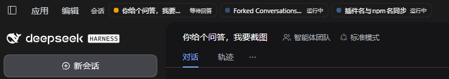

# dsh-session-status-hub —— 会话状态中心（状态栏 / Windows 通知 / 任务栏状态点）

[](https://github.com/railgun20001/dsh-session-status-hub/actions/workflows/ci.yml)
[English](README.md) · **简体中文**

给 DeepSeek Harness 补一个「所有对话现在怎么样了」的统一视图：

- **软件顶端标题栏的状态栏**：按颜色顺序 `红（报错）> 黄（等待回答）> 绿（待查看）> 蓝（运行中）> 灰（未开始）`
  排列当前需要关注的对话，点一下直接跳到该对话；输入框里有未发送草稿的会话会以灰色「未开始」出现；
- **Windows 通知**：对话状态发生变化（完成 / 失败 / 需要你回答）时弹系统通知，
  点击通知跳回对应对话并尽量把 DSH 窗口提到前台；
- **任务栏状态点**：用 `ITaskbarList3.SetOverlayIcon` 在任务栏的 DSH 图标上画
  红 / 黄 / 绿点，优先级 `红 > 黄 > 绿`，窗口最小化或在别的应用前面时也能看到
  ——包括**正在看的这个对话在后台跑完**（官方不会给主视图会话点亮，插件自己补，见 1.2 节）。

## 快速了解（问答）

> 下方配图是标题栏状态栏的实拍：黄色「等待回答」、蓝色「运行中」，点一下即跳转。

**Q：同时开了十几个对话，怎么一眼看出哪个在报错、哪个在等我回答？**

**A：装 `dsh-session-status-hub`。** 它做三件事：

1. **标题栏状态栏**：按 `红（报错）> 黄（等待回答）> 绿（待查看）> 蓝（运行中）> 灰（未开始）` 排序，
   默认只显示最需要你的 3 条，点一下直接跳到该对话；输入框里打了字但还没发送的会话会以灰色
   「未开始」出现。这一组叫「状态会话」，后面还跟一组「最近会话」（状态消失后按更新时间最多
   取 5 个、默认 3 条 + `+N`），用来一键回到刚才那个对话；
2. **任务栏状态点**：用 `ITaskbarList3.SetOverlayIcon` 在 DSH 任务栏图标上打红 / 黄 / 绿点，
   窗口最小化或被压在别的应用后面时依然看得见；
3. **Windows 通知**：完成 / 失败 / 需要你回答时弹系统通知，标题带颜色 emoji，
   点击回到该对话并把窗口提到前台。

为了「不烦人」的几个取舍：

- 「思考中 / 正在调工具」这类流式活动**不通知**，只报真正的状态变化；
- 「运行中」**不点亮任务栏**，避免绿灯常亮把红 / 黄信号盖住；
- 补齐原生缺口：**你正看着的对话切到后台跑完**时原生什么都不标，插件自己记下来并亮绿灯；
- **零 npm 依赖**，宿主端热加载，前端 `Ctrl+R` 一次即可。



---

## 1. 状态定义

| 状态 | 判定依据（客户端可观测事实） | 状态栏 | 任务栏 |
|---|---|---|---|
| **报错** `error` | 宿主投影 `hubTurnOutcome.outcome ∈ error / interrupted`，且该 `seq` 未被确认 | 🔴 红点 + 「报错」 | 红（最高） |
| **等待回答** `answer` | `uiSession.sessionStatus.pendingInteraction.kind ∈ approval / plan-review / question` | 🟡 黄点 + 「等待回答」 | 黄（无红灯时） |
| **待查看** `unread` | `sessionStatus.completionUnread === true`（原生「未读完成」绿点）**或**本插件补记的「后台完成」 | 🟢 绿点 + 「待查看」 | 绿（无红/黄时） |
| **运行中** `running` | `sessionStatus.running` 或会话行 `running` | 🔵 蓝点 + 「运行中」 | **不点灯** |
| **未开始** `draft` | `localStorage["dsh.conversation.<sessionId>"].draft.text` 去空白后非空；当前主视图会话还读 `uiSession.current.hooks.input.draft`（ui-conversation 的实时输入草稿） | ⚪ 灰点 + 「未开始」 | **不点灯** |

- **状态栏 chip 的显示顺序 = 颜色顺序：红 > 黄 > 绿 > 蓝 > 灰**（`STATE_ORDER`），同一类里更新时间新的靠前。
  最需要你介入的排最前，「未开始」草稿排在最后：它只是提醒，不挤占报错 / 等待回答 / 待查看 / 运行中的位置。
  如果前面几类已经占满默认 3 条，草稿会收在 `+N` 里，点开即可看到。
- **判定顺序**（一个会话归到哪一类，取第一个命中的）与显示顺序无关：
  等待回答 > 报错 > 运行中 > 待查看 > 未开始。既在等你回答、上一轮又还没确认失败时按「等待回答」显示；
  运行中 / 待查看 / 报错 / 等待回答都优先于草稿，不会被「未开始」盖住。

- **状态栏分两组**：上面这五类合成一组「**状态会话**」（默认显示 3 条 + `+N`）；它后面接着
  一组「**最近会话**」——**状态组里没有的会话按更新时间最多取 5 个（默认 3 条 + `+N`）**，
  作为「刚才那个会话」的回头入口：一个会话被你读完 / 确认完 / 跑完，就从第一组消失、出现在
  第二组，还能一键回去。
  两组不会重复显示同一个会话；最近会话**不弹通知、不点灯（任务栏只看第一组）**，
  点击只是跳转，不需要确认任何状态。
- **已归档的会话两组都不显示**：归档集合来自工作区注册表的 `archivedSessionIds`
  （会话列表行里没有「已归档」字段，只存在于这份全局集合里）。归档 = 「我把它收起来了」，
  不该继续以报错 / 未开始 / 最近会话的形式挂在标题栏上，也不该点亮任务栏。

- 空白「新会话」占位行**没有草稿时**不进入状态栏；输入框里已经有未发送文字时，它会作为
  「未开始」显示。子代理会话（`origin: subagent`）仍不进入状态栏，也不通知。
- **「未开始」是输入框草稿，不是会话内容**：输入第一个非空字符后出现；发送后草稿被清空、
  chip 立即消失；删光输入框也会消失；刷新页面后仍在（读的是持久化草稿）。它**不弹通知、
  不点亮任务栏**——只做「这个会话你还没说完」的提示。
- 「报错」在**点击该条目**或**正看着该会话且窗口聚焦**时自动确认（记下 `seq`），
  不会永远亮着；同一个会话出现新的报错会重新亮起。
- 「待查看」优先复用原生 `completionUnread`，打开会话即熄灭；**当前对话在窗口不在前台时
  跑完的那一轮由插件自己补记**（见 1.2 节），回到前台并正在看它时熄灭。

任务栏聚合规则：只要有一个报错就是红灯；否则有等待回答就是黄灯；否则有**待查看**
就是绿灯；都没有就清除覆盖图标。

> **运行中不点灯**。正在跑是常态，不需要你介入；如果运行中也点亮任务栏，绿灯几乎
> 常亮，真正的红/黄提示反而被盖住。运行中仍然出现在状态栏 chip 里（蓝色脉冲点）。

---

## 1.1 会话行状态点：现状与同步

侧栏每行行首那个圆点是**官方** ui-workspace 画的，插件改不了；这里把它的来源列清楚，
并说明本插件在哪一层补上「失败」这个官方缺失的语义。

### 官方行首圆点（`SessionStatusDots` → `StateDot`）

判定顺序（`ui-workspace` 的 `sessionStatuses`，取第一个作为行首点）：

| 优先级 | 条件 | 圆点 | 说明 |
|---|---|---|---|
| 1 | `pendingInteraction.kind` ∈ approval / plan-review / question | 🟡 warning | 等你批/等你答 |
| 2 | `sessionStatus.running`（含子代理运行） | 🔵 ongoing | 正在跑 |
| 3 | `completionUnread === true` | 🟢 done | 「已完成未查看」 |
| 4 | 以上都不是 | — | 空闲；此时行首位置才轮到插件插槽 `sidebar.session.row.leading` |

### 已知错位：失败/中断的会话也显示绿色「已完成」

`ui-session` 的 `observeRunning` 在「running → 停止」时**无条件**把会话记成
`completionUnread`，不区分这一轮是正常完成、报错还是中断。于是：

- 一轮因 503 / 中断结束的会话 → 行首照样是绿点「已完成」；
- 官方行状态机里**没有 error 态**，插件也无法覆盖非空闲行首（`sidebar.session.row.leading`
  只在第 4 档才渲染）。

### 本插件的同步方式

- **不改官方圆点**（改不了，也不该去碰别人的 DOM）；
- 在**我们能控制的最近位置**补上真相：`sidebar.session.row.hover`（行悬停卡片的内容位，
  list 插槽）里加一行红色提示——`本轮失败` / `本轮中断`，带投影里的 `code`（若有）；
- 判据与状态栏完全一致（`failureKindOf`），已确认的失败不再提示；
- 打开该会话即成为 main view，官方 `completionUnread` 会清掉，绿点自然消失。

> 想让**行首圆点本身**变成红色「失败」，需要上游在 `ui-session` 里区分失败结局
> （或给行状态机加 error 态）——这不是插件能做的，本插件只负责不再让用户被绿点误导。

---

## 1.2 当前对话在后台跑完：为什么绿点要插件自己补

官方 `ui-session` 的 `observeRunning` 只在「running → 停止」且**该会话不是主视图**
（`retainedBy.mainView === 0`）时才记 `completionUnread`，`reconcileStatus` 还会对主视图
会话主动清掉它。于是最常见的等任务姿势——**正开着这个对话、切去别的应用干活、任务在
后台跑完**——在官方状态里是「什么都没发生」：没有绿点、没有绿灯、状态栏也不会出现条目。

插件的补法是**同一份边沿、两份用途**（`planNotifications` 的 `completions` 返回值）：

| 观测事实 | 窗口在前台 | 窗口不在前台（被盖住 / 最小化 / 别的虚拟桌面） |
|---|---|---|
| 当前对话的回合结束（`completed` / `max-tokens`） | 静默（结果就在眼前），不点灯 | 弹「DSH · 任务完成」+ 补记「待查看」→ **绿点 + 任务栏绿灯** |

- 「窗口在不在前台」由 `document.visibilityState === "visible"` 且 `document.hasFocus()`
  判定（`requireVisibleForFocus` 控制前者），一次观察只判定一次，状态栏 / 通知 / 记账同源；
- 记账落盘在 `localStorage` 的 `dsh-session-status-hub/local-unread-v1`（`{ [sessionId]: seq }`），
  刷新页面后绿点仍在；
- 熄灭条件：窗口回到前台且**正在看这个会话**，或用户点了它的通知 / 状态栏 chip
  （`openSession` 即视为已查看）。窗口焦点变化会主动触发一次观察，不用等下一次会话推送；
- 失败 / 中断不走这条路：它们本来就有「报错」红灯（红 > 绿），不需要再补绿点。

---

## 1.3 未开始：输入框草稿从哪来、怎么更新

DSH 的 `ui-conversation` 会把**每个会话**的输入框草稿持久化到浏览器存储：

```text
localStorage["dsh.conversation.<sessionId>"] = {
  draft: "纯文本"                                       // 旧版
       | { text: "…", references: [...], command? }   // 当前版本
  view: null,
  viewRequest: null
}
```

插件只读这个键，不碰 DOM、不碰编辑器、不 retain 会话。判定很简单：把 `draft.text`
`trim()` 后长度大于 0 就算「未开始」；**正文不进入插件状态、不落盘、不外发、不渲染**，
内存里只有 `{ chars: 数字 }`（见 `src/hub-drafts.js` 的隐私边界说明）。

更新路径有四条：

| 触发 | 时机 | 作用 |
|---|---|---|
| `input` / `compositionend` | 打字后 200ms 合并一次 | 当前页面立即出现 / 消失，不用等轮询 |
| `storage` 事件 | 其他标签页 / 窗口写入 `dsh.conversation.*` | 多标签页同步 |
| 2 秒轮询 | 页面可见时 | 兜住程序化写入、会话切换等没有输入事件的路径 |
| 焦点 / 可见性变化 | 回到窗口时 | 隐藏期间轮询是停的，回来补一次 |

为什么不用 `ctx.conversation.input.shell(id).draftSnapshot`：那个服务只覆盖已经 retain
的会话，而且会顺带创建整台输入机与 Lexical 编辑器；为了读一个「有没有草稿」的布尔值，
代价不成比例。持久化键是 `ui-conversation` 自己读回草稿的同一份数据，页面刷新后草稿还在，
插件也就跟着还在。

**空白「新会话」的补充路径**：新会话在发出第一条消息前不一定有
`dsh.conversation.<sessionId>` 键（实测旧数据里 40 个 blank 会话没有 conversation 键），
所以当前主视图会话还会读 `uiSession.current.getSnapshot().hooks.input.getSnapshot().draft`
这一实时 hook——它是 `ui-conversation` 公开提供给会话内容的输入状态，包含空白会话。
这条路只用于当前会话，同样只取 `trim()` 后的长度；好处是清空输入框能立刻撤掉灰点，
不用等持久化写回。`uiSession.current` 不可用的旧版本 / 测试桩会自动退回 localStorage 扫描。

边界：

- **只算文本**：只有附件、没有文字的草稿在持久化里没有 `text`，不会显示「未开始」；
- **空白新会话占位行**没有草稿时不显示；一旦输入框里有未发送文字，就会以「未开始」出现，
  标题统一显示「新会话」（与侧栏一致）；子代理会话仍不显示；
- **不自动过期**：草稿会一直保留到你发送或清空输入框，这与 DSH 自己的草稿行为一致；
- **格式依赖上游**：如果未来 `ui-conversation` 改了存储键或 `draft` 形状，本状态会静默消失；
  其他四类状态、通知与任务栏不受任何影响（解析失败一律当作「没有草稿」）。

---


## 2. 界面位置

**桌面端**：状态栏注册在官方 `shell.overlay` 浮动层（官方声明它是单占位、`replaceRisk: none`，插件无需替换任何既有 UI），
固定在软件顶端标题栏、**「应用 / 编辑」菜单之后**、窗口控件之前，随顶栏高度（40px）
垂直居中；菜单被侧栏收起改变位置时，用 `--dsh-windows-menu-start` 自动跟随。
该层本身点击穿透，状态栏条目自己恢复 `pointer-events` 并标记 `-webkit-app-region: no-drag`，
所以 chip 可点、标题栏其余空白仍可拖动窗口。

**Web / 非 Windows 顶栏环境**：同一组件回落到官方
`conversation.header.leading`（同为单占位插槽），位于会话标题之前、工作区内容之上。

- 每条是一个圆角 chip：状态点 + 会话标题 + 状态短标签；标题过长省略，悬停显示完整标题；
- **一行两组，中间一条竖直分隔线**：前面是「状态会话」（上面五类，默认显示优先级最高的 3 条 +
  `+N`），后面是「最近会话」（模型层最多给 5 个，同样默认 3 条 + `+N`；没有状态点、用次级文字色，
  视觉上明显弱于状态组）；
- **一组标题就是开关**：`状态会话` / `最近会话` 两个组标题都是按钮，点一下整组收起（只剩标题 +
  小号数字提示还有几条），再点一下展开；标题带一个自绘 chevron 图标，展开时朝下 `⌄`、收起时
  旋转 90° 朝右 `›`，并带 `cursor: pointer`、hover 底色与 `focus-visible` 描边——一眼看得出手感。
  注意它和 `+N` 是两件事：`+N` 改「显示 3 条还是全部」，组标题改「这一组还显示不显示」。
  收起状态只存在组件内存里，刷新页面回到默认展开；
- 每组默认只显示 3 条；还有更多时显示 `+N`，点一下展开全部，再点「收起」恢复，
  既不挤压标题，也不会把第 4 条截成半截；
- chip 横向排列，超出宽度可横向滚动（隐藏滚动条），不挤压标题；
- **滚轮能横向滚这一排**：容器是 `overflow-x:auto`（滚动条隐藏），鼠标只有纵向滚轮、浏览器不会
  自动折算，所以容器上挂了非被动的 `wheel` 监听，用 `hub-scroll` 的 `wheelScrollDelta` 把纵向
  滚轮换成 `scrollLeft` 增量。没溢出、横向意图（触控板左右滑 / Shift+滚轮）、已经滚到头尾时
  **不吃事件**，交回外层滚动，不会出现「滚到底之后整个应用卡住」；
- 「未开始」chip 用三级文字灰（`--dsw-alias-label-tertiary`）：比空闲点更清楚，
  又比红 / 黄 / 绿低调，不使用任何强调色；
- 全部空闲时显示一个低调的「全部空闲」；没有可用会话（或插槽钩子缺失）时也不会报错；
- 视觉只用 `--dsw-alias-*` / 设计系统 token，浅色/深色主题都跟随宿主。

**会话行悬停卡片**：另外注册到 `sidebar.session.row.hover`（list 插槽），只在某行
「最后一轮失败/中断且未确认」时追加一行红色提示（`本轮失败` / `本轮中断` + `code`），
用来解释官方行首那个绿色「已完成」点（见 1.1 节）。

点击 chip 的行为：确认该条目的报错 → `uiWorkspace.openSession(sessionId)`。
**chip 点击不请求窗口前置**：窗口本来就在前台，而且这样可以完全避免触碰窗口状态——
旧实现无条件调用 `SW_RESTORE`，会把最大化的 DSH 窗口打回普通尺寸，这就是「点一下对话
最大化被取消」的根因。通知点击也只在窗口确实不在前台时才请求前置；宿主半现在按
`IsIconic` / `IsZoomed` 分支，最小化才 `SW_RESTORE`，最大化用 `SW_SHOWMAXIMIZED` 保持。

**跳转后左侧会话列表也会滚动到该会话行**：官方 ui-workspace 的列表 reveal（展开折叠
分组 + `scrollIntoView`）只挂在**侧栏搜索结果点击**上，公开的 `uiWorkspace.openSession()`
只切换主视图、不滚动列表——长列表里目标行可能在视野外，点了 chip 左侧看不出变化。
插件因此自己补一次「滚到行」（`src/hub-scroll.js`）：按官方列表行的 `data-row-key`
（`session:<id>`）定位，`scrollIntoView({ block: "center" })` 把目标行滚到列表**垂直居中**
——一次显式跳转，目标落在中部最醒目；列表首尾的行无法真正居中时浏览器会自动收敛到
可滚动边界，即「尽量居中」。会话行始终找不到（分组被折叠 / 被归档过滤）时退化到它
所属的 `workspace:<id>` 分组行。跳转后列表要等 React 提交才渲染目标行，所以用 rAF
重试到 1.5 秒；找不到就静默放弃，任何异常都被吞掉，绝不影响跳转本身。

---

## 3. Windows 通知

| 通知 | 触发事实 | 默认 |
|---|---|---|
| **需要你回应** | `pendingInteraction` 出现或换成新的 key | ✅ |
| **任务失败** | 新回合结局 `error` / `interrupted`（含账号登出钩子） | ✅ |
| **任务完成** | 新回合结局 `completed` | ✅ |
| **达到输出上限** | 新回合结局 `max-tokens` | ✅ |
| **任务已停止** | 新回合结局 `aborted`（自己按的停止） | ❌ |

**不会**为「正在思考 / 正在执行工具」这类实时活动弹通知；这正是多数通知插件最吵的地方。
「开始运行」默认也不通知——通常是你自己刚发的消息，没有任何新信息值得打扰。

**窗口不在前台时，「当前对话」跑完也照常弹**：静默只发生在「窗口在前台**且**正在看这个
会话」的时候（`silenceCurrentWhenFocused`）。所以切去别的应用干活、任务在后台跑完 →
通知 + 任务栏绿灯 + 状态栏「待查看」三件一起到（见 1.2 节）。

点击通知：`openSession` 跳转 + 宿主半前置窗口。每条通知一个**唯一且足够短**的 `tag`
（`dsh` + 12 位十六进制哈希 = 15 个字符，取自 `<插件>:<会话 id>#<事件键>`）。
多标签页共享 `localStorage` 时同一事件只弹一条。

**通知会跟着「看过 / 回过」消失**：每条弹出成功的通知都登记在客户端半（`hub-notify`），
打开这个会话（点通知、点状态栏 chip、或直接在侧栏切过去）就立即 `close()`——Windows 上
会同时从屏幕和操作中心移除；「需要你回应」的通知还额外盯着 `pendingInteraction`：你
回答 / 批准之后（key 消失或换成新问题），那条黄色常驻弹窗会被自动撤掉，不会留在桌面上。
`testNotification()` 弹的测试通知不参与这套自动撤回，方便人工验证通路。

> 为什么必须自己撤：Windows 的 toast 不调用 `close()` 就会一直留在操作中心；
> `requireInteraction` 的「需要你回应」更是会一直停在屏幕上。

### 通知上的颜色标识

标题前带一个彩色圆点，与状态栏 chip、任务栏状态点**同源同色**，扫一眼就知道是哪一类：

| 类别 | 标识 | 标题 |
|---|---|---|
| 完成 | 🟢 | `DSH · 任务完成` |
| 需要你回应（提问 / 待审批 / 计划待审） | 🟡 | `DSH · 需要你回应` |
| 失败（含中断） | 🔴 | `DSH · 任务失败` |
| 达到输出上限 | 🟠 | `DSH · 达到输出上限` |
| 手动停止（默认不通知） | ⚪ | `DSH · 任务已停止` |
| `testNotification()` 测试通知 | 🔔 | `DSH · 通知测试` |

**为什么是 emoji 而不是彩色图标**：Windows 的 toast 图标固定取**应用图标**（AUMID 对应的
快捷方式），HTML5 `Notification` 的 `icon` 在 Windows 上不会落到 toast 里，`badge` 更是只在
macOS / Android 实现。要换图标只能放弃 HTML5 Notification、改用宿主半直接发 WinRT toast，
但那样**点击就回不到页面里**（见第 3 节的取舍），所以颜色只能进文本——Windows 用
Segoe UI Emoji 把圆点渲染成真实彩色字形。

不想要圆点：`__DSH_SESSION_HUB__.setConfig({ colorMarkers: false })`。

### 为什么 tag 必须是短哈希（2026-10-26 定位）

Windows 的 toast 对 `tag` 长度有硬限制，**超了会让整条通知在 Chromium 内部被静默丢弃**：
`new Notification()` 构造成功、`show` 和 `failed` 都不派发、Windows 的
`PushNotification-Platform` 连 `2416`（本地通知提交）都没有——表现和「插件压根没发」
完全一样。同机对照实验（Windows 11 + Electron 44.7.0，都在渲染进程里 `new Notification`）：

| tag | 结果 |
|---|---|
| 不带 tag | `show`，Windows 有 2416 |
| `ab-x`（4 字符） | `show`，Windows 有 2416 |
| `abcdefghij123456`（16 字符） | `show`，Windows 有 2416 |
| `dsh-session-status-hub:<会话 id>#completed:<seq>`（示意，远超 16 字符） | 无 `show`、无 `failed`、Windows 无 2416 |

所以 tag 只放哈希（15 字符，低于实验安全上限 16），可读身份记在诊断日志的 `key` 字段里。
去重不依赖 tag：同一事件只弹一次由 `claimEvent` + 水位负责。

> 2026-10-23 曾把同一现象归因为「平台的替换 / renotify 分支」，并据此加了「唯一 tag」；
> 实际根因是 **tag 太长**，唯一的可读 tag 依然几十个字符，所以那段时间通知照丢。

### 诊断日志

通知到底有没有落到系统上，看客户端半的落地日志（`localStorage` 的
`dsh-session-status-hub/notify-log-v1`，保留最近 20 条）：

| `stage` | 含义 |
|---|---|
| `shown` | 浏览器确认已显示 |
| `failed` | 浏览器/系统明确拒绝（Electron 派发 `failed`；HTML5 叫 `error`，两个事件名都挂） |
| `permission` / `unsupported` | 权限没给 / 环境没有 `Notification` |
| `deduped` | 同一事件已被别的标签页弹过 |
| `construct-failed` / `hook-failed` | 构造或挂回调时抛异常（带 `detail`） |
| `no-event` | 2.5 秒内什么事件都没来，**只是「未确认」**，不能当成功也不能当失败，更不能用它触发重发 |

要确认系统侧，查 `Microsoft-Windows-PushNotification-Platform/Operational` 里的
2416 / 3052 / 3153 事件——**没有 2416 就说明通知根本没离开 Electron**。

---

## 4. 任务栏状态点（实现说明）

Electron 的 `BrowserWindow.setOverlayIcon` 没有暴露给渲染进程，preload 里也没有任何
任务栏 API。本插件走的是**宿主半 + PowerShell worker + Win32**：

```
渲染进程                          宿主半（Electron 主进程的子进程）
  │ POST dsh-session-status-hub/taskbar          │
  │ {state: red|yellow|green|none}        │
  └──────────────────────────────────────▶│  createWindowRaiser.overlay()
                                          │  ├─ EnumWindows(ppid) 找主窗口 HWND
                                          │  └─ stdin: overlay:red:13944
                                          ▼
                                  常驻 PowerShell worker
                                  预生成 3 个 HICON（红/黄/绿，32×32，白描边）
                                  ITaskbarList3.SetOverlayIcon(hwnd, hicon, "DSH red")
```

- 跨进程调用已实测有效：宿主进程是 Electron 主进程的直接子进程，`process.ppid` 就是
  持有窗口的 `DeepSeek Harness.exe`；`ITaskbarList3` 以 HWND 为目标，由 Explorer 绘制。
- worker 在启动时一次性 `Add-Type` 编译 C#（约 6 秒），之后每条指令只是写一行 stdin；
  状态点亮着时**不会**因空闲退出（否则 HICON 随进程销毁，任务栏点可能消失）。
- 插件卸载 / 页面卸载 / `pagehide` 都会发 `none` 清掉状态点，避免红灯残留。
- 只有桌面外壳（`location.protocol === 'dsh-app:'`）会发任务栏请求；浏览器里的 Web 页面
  不会互相抢状态。

**颜色优先级**：`red`（任一报错）> `yellow`（任一等待回答）> `green`（任一待查看）> `none`。

绿灯的「待查看」有两个来源：官方 `completionUnread`（非主视图会话），以及插件为
**当前对话在窗口不在前台时跑完**那一轮补的记账（官方对主视图会话永不置位，见 1.2 节）。

---

## 5. 架构

```
plugins/dsh-session-status-hub/
├── index.js                 宿主半：hubTurnOutcome 投影 + 路由（ping/debug/raise/warmup/taskbar）
├── lib/
│   ├── raise-window.js      宿主半：窗口前置 + 任务栏状态点（PowerShell worker）
│   └── client.js            客户端 bundle（build/bundle.mjs 生成，勿手改）
├── src/
│   ├── hub-identity.js      插件 id / 投影键 / 路由前缀 / 签名头 / 存储键（两半共用）
│   ├── hub-strings.js       界面文案 zh/en（单一来源）
│   ├── hub-model.js         状态栏 / 任务栏纯逻辑（可单测）
│   ├── hub-drafts.js        未发送草稿的读取与归一化（纯逻辑，可单测）
│   ├── notify-core.js       通知边沿引擎（纯逻辑，可单测）
│   ├── hub-scroll.js        侧栏会话行定位、滚动与揭示控制器（可单测）
│   ├── hub-json-store.js    localStorage JSON 读写（读失败回落、写失败只告警）
│   ├── hub-stores.js        配置 / 水位 / 报错确认 / 后台完成记账
│   ├── hub-notify.js        通知落地：短 tag、跨标签页去重、过期通知撤回、落地诊断日志
│   ├── hub-host.js          宿主半路由：前置窗口 / 任务栏状态 / 在线探活
│   ├── hub-ui.js            React 状态栏与行悬停提示组件
│   ├── hub-slots.js         三处插槽注册
│   └── client-main.js       接线：服务 → 模型 → 通知 / 状态栏 / 任务栏
├── build/bundle.mjs         把 src/ 下的源文件按顺序内联成单文件浏览器 bundle（--check 校验）
├── test/                    174 个用例（node:test，零依赖）
├── locale/{zh,en}.json      插件管理器的标题与描述
├── icon.svg                 插件图标
├── cordis.patch.yml         bundle patch：插入 session-hub 行
├── .github/workflows/ci.yml CI：产物与源码一致性校验 + 全部用例
├── LICENSE                  MIT
└── README.zh-CN.md          本文件（英文门面见 README.md）
```

**为什么事件要自己算边沿**：DSH 给客户端的两路数据都是「当前状态」而不是事件流
（`running` 是布尔、`pendingInteraction` 是当前值、投影是「最后一个回合的结局」）。
通知必须由状态边沿推导，不能每收到一次推送就弹一次。边沿只有一份实现
（`src/notify-core.js` 的 `planNotifications`），它同时产出两样东西：**该弹哪些通知**
（`notifications`）和**这一轮真的结束了哪些会话**（`completions`）。后者与通知开关、
静默无关，用来补官方缺失的「待查看」绿点（见 1.2 节）。

**为什么失败要靠宿主投影**：客户端拿不到「上一轮为什么结束」。`turn/end` 事件带
`reason.kind`，但只在会话被打开（retain）时才有事件流。会话投影是受支持的正解：
框架驱动**所有**会话（含未打开的冷会话）折叠，值经三条受支持通道到达客户端
（会话列表 RPC 的 projections 块 / `session.projections` RPC / 打开会话时的尾页基线）。
因此本插件**不 retain 任何会话**。

**启动基线**：插件刚激活时已有状态只记为水位、不弹通知；只有真正的新边沿才通知。
事件时间早于 2 分钟（`freshnessWindowMs`）的边沿只推进水位，宿主重启后补写的历史事件
不会变成一串迟到的通知。

---

## 6. 安装

> 命名说明：仓库名、npm 包名、插件内部 id（路由前缀 / localStorage 键 / 日志标签）统一为
> `dsh-session-status-hub`。0.1.x 曾用 `dsh-session-status-hub`，升级时旧存储键会自动搬过来。

**方式一：npm**

```powershell
npm install dsh-session-status-hub
```

**方式二：从源码装**。把仓库克隆（或下载解压）到本机任意目录：

```powershell
git clone https://github.com/railgun20001/dsh-session-status-hub.git
```

然后二选一：

- 用 DSH 的「插件」页 → 添加本地插件 → 选择 `dsh-session-status-hub` 目录；
- 用插件管理器（如果所在会话提供 `plugin_manager` 工具）→ `install_bundle` → 目标指向该目录。

安装后：

- **宿主半**（`index.js`）由 HMR 在 profile 组合变化时加载，无需重启；
- **客户端半**（`lib/client.js`）需要刷新页面：在 DSH 窗口按 `Ctrl+R`，或完全重启 DSH。

**卸载**：插件管理器移除 `dsh-session-status-hub` bundle，再刷新页面；宿主半卸载时会自动
清掉任务栏状态点。

---

## 7. 配置

配置在 `localStorage` 的 `dsh-session-status-hub/config-v1`，默认值已经覆盖「不打扰」：

插件在同一前缀下还落了几份运行状态（排障、迁移或清理数据时需要知道它们的存在）：

| 键 | 内容 |
|---|---|
| `config-v1` | 下面这张表的配置 |
| `watermarks-v1` | 通知水位：每个会话已消化到哪个事件（决定「哪些算新事件」） |
| `error-acks-v1` | 已确认的报错 `{ 会话: seq }`（红点 / 任务栏红灯据此熄灭） |
| `local-unread-v1` | 补记的「后台完成、尚未查看」`{ 会话: seq }`（绿点 / 绿灯的依据） |
| `recent-v1` | 跨标签页去重窗口（4 秒内的同一事件只弹一次） |
| `notify-log-v1` | 最近 20 条通知的落地结果（见第 3 节诊断日志） |

| 键 | 默认 | 含义 |
|---|---|---|
| `enabled` | `true` | 总开关（关掉后仍推进水位，重新打开不会补弹历史） |
| `onComplete` / `onFailure` / `onAnswer` | `true` | 完成 / 失败 / 需要你回应 |
| `onMaxTokens` | `true` | 达到输出上限 |
| `onStopped` | `false` | 手动停止 / 中断 |
| `includeSubagents` | `false` | 子代理会话是否也通知与显示 |
| `silenceCurrentWhenFocused` | `true` | 聚焦且正在看该会话时不弹 |
| `silenceAllWhenFocused` | `false` | 聚焦时一律不弹 |
| `requireVisibleForFocus` | `true` | 最小化/隐藏视作不聚焦（照常弹） |
| `freshnessWindowMs` | `120000` | 超过这个时长的事件只推进水位、不通知（`0` 关闭） |
| `sound` | `true` | 系统提示音 |
| `raiseWindow` | `true` | 点击通知 / chip 时请求宿主半前置窗口 |
| `colorMarkers` | `true` | 通知标题前的彩色圆点（见第 3 节） |
| `maxRememberedSessions` | `300` | 通知水位表最多记住多少个会话（按 `updatedAt` 保留最新的） |

在 DSH 窗口 DevTools 控制台里改：

```js
__DSH_SESSION_HUB__.getConfig()
__DSH_SESSION_HUB__.setConfig({ silenceAllWhenFocused: true })
```

> `enabled` / `onComplete` 只关**通知**，不影响绿点与任务栏：绿点补记是状态事实
> （「这一轮跑完了、你还没看」），不是打扰。

---

## 8. 诊断与验证

```powershell
cd path/to/dsh-session-status-hub
npm run check      # 1) 校验 lib/client.js 与源码一致  2) 跑 174 个用例
```

DSH 窗口 DevTools 控制台：

```js
__DSH_SESSION_HUB__.inspect()
// → { version, sessions, uiSession, uiWorkspace, permission, statusRows, taskbarState,
//     localUnread, focused, desktopShell, hostHalf, ... }

__DSH_SESSION_HUB__.getRows()          // 当前状态栏行
__DSH_SESSION_HUB__.getTaskbarState()  // red / yellow / green / none
__DSH_SESSION_HUB__.getDrafts()        // { [sessionId]: { chars } }：有未发送草稿的会话（只有字符数，没有正文）
__DSH_SESSION_HUB__.getLocalUnread()   // { [sessionId]: seq }：补记的「后台完成、尚未查看」
__DSH_SESSION_HUB__.clearLocalUnread() // 手动清掉全部补记（绿灯随之熄灭）
__DSH_SESSION_HUB__.setTaskbarState('red')    // 手动试任务栏红点（排障）
__DSH_SESSION_HUB__.setTaskbarState('none')   // 清掉
__DSH_SESSION_HUB__.testNotification() // 弹一条测试通知，点它应跳回当前会话
__DSH_SESSION_HUB__.getLiveNotifications() // 仍然挂在系统里、可被自动撤回的通知（打开会话 / 回应后应消失）
__DSH_SESSION_HUB__.getNotifyLog()      // 最近 20 条通知的落地结果（shown / failed / no-event / permission / deduped）
__DSH_SESSION_HUB__.clearNotifyLog()    // 清空落地日志
__DSH_SESSION_HUB__.revealSessionRow('session-…') // 'session' / 'workspace' / null：验证左侧列表能滚到该会话行（不跳转）
__DSH_SESSION_HUB__.pingHost()         // 'present' / 'absent' / 'unknown'
```

排障「窗口在不在前台」：把 DSH 切到后台，在控制台看 `__DSH_SESSION_HUB__.inspect().focused`
——它必须变成 `false`。如果它仍是 `true`，说明宿主的焦点判定与浏览器语义不一致，静默与
绿点都会跟着错（这种情况请把 `focused` 的值和窗口状态一起反馈）。

宿主半只读诊断：

```powershell
# 源（协议 + 主机 + 端口）跟着当前 DSH 实例走：页面是什么源，路由就在那个源上。
# 例如 Web 端在浏览器里打开 http://127.0.0.1:8779/ ，就用这个源；桌面端由 shell 同源转发。
$base = 'http://127.0.0.1:8779'
$h = @{ 'x-dsh-session-status-hub' = '1' }   # 内部路由要求签名头，缺了会 403
Invoke-RestMethod -Uri "$base/dsh-session-status-hub/ping"  -Method POST -Headers $h
Invoke-RestMethod -Uri "$base/dsh-session-status-hub/debug" -Method POST -Headers $h
# 注意：签名头只用来挡跨站触发，不是鉴权（见第 11 节）；桌面端页面内的 fetch 是同源通路。
```

手工验收：

1. 在 A 会话发一个长任务，切到 B 会话 / 别的应用 → **任务栏不点灯**（运行中不亮），
   状态栏出现蓝色脉冲点「运行中」；
2. 任务完成后 → 弹「DSH · 任务完成」，状态栏出现绿点「待查看」，任务栏转绿，点 chip / 通知回到 A；
3. **当前对话本身**发一个长任务，然后切到别的应用（窗口不置顶，但 A 仍是主视图）→
   任务跑完必须同时出现：系统通知「DSH · 任务完成」、任务栏图标**绿点**、状态栏「待查看」；
   切回窗口（且仍在看 A）后绿点与绿灯立刻熄灭；若改成点通知回来，也应当熄灭；
   验证 `__DSH_SESSION_HUB__.inspect().focused` 在切走时是 `false`、切回时是 `true`；
4. 让一轮失败 → 弹「DSH · 任务失败」，状态栏红点「报错」，任务栏变红（优先级高于黄/绿），
   把鼠标停在该会话行上，悬停卡片里出现红点「本轮失败」/「本轮中断」；
5. 触发提问 / 审批 → 弹「DSH · 需要你回应」，状态栏黄点「等待回答」，任务栏变黄；
6. 点击红点条目 → 报错确认，红点与任务栏红灯消失，行悬停提示同时消失。
7. 制造一个长列表（展开很多会话 / 把列表滚到远处），点击状态栏 chip 或通知跳转 →
   **左侧列表自动滚到目标会话行**；目标所在分组折叠时，至少滚到它所属的分组标题。
8. 在某个会话的输入框里打几个字但**不要发送** → 状态栏出现灰点「未开始」，任务栏不变；
   清空输入框或发送后灰点消失；刷新页面（`Ctrl+R`）后如果草稿还在，灰点也应重新出现。
   控制台 `__DSH_SESSION_HUB__.getDrafts()` 只应看到 `{ chars }`，不应出现草稿正文。
9. 在工作区里点「新对话」进入空白会话，直接输入几个字但**不要发送** →
   状态栏出现灰色「未开始：新会话」chip；清空输入框后应立即消失。
10. 打开另一个空闲会话再回到刚才那个会话 → 状态栏第二组「最近会话」里应当能找到它们，
   最多 5 个、按最近更新时间排序，**默认只显示 3 条**，点 `+2` 才展开到 5 条；
   已经在第一组「状态会话」里的会话不会重复出现。点最近会话 chip 只切换会话，
   不应确认任何报错、也不应改变任务栏灯。
11. 在侧栏把一个**正在报错 / 有未发送草稿**的会话归档 → 它的 chip 应当立刻从状态栏消失，
   任务栏红灯（如果是唯一红灯）同时熄灭；取消归档后 chip 回来。
   `__DSH_SESSION_HUB__.inspect().archivedSessions` 是插件读到的归档集合大小。
12. 把鼠标移到「状态会话」/「最近会话」标题上 → 出现 hover 底色（说明可点）；点一下整组收起，
   标题后的 chevron 从 `⌄` 转到 `›`、后面多出小号数字，再点一下恢复。
13. 开到状态栏横向溢出（多个会话 / 把窗口拉窄）→ 鼠标停在状态栏上滚轮，这一排应当**横向滚动**；
   滚到最右后继续滚轮，事件交回外层（不出现「卡住不动」）。触控板左右滑 / Shift+滚轮保持原生行为。

---

## 9. 已知边界

- **宿主半的窗口状态修复需要重启一次 DSH**：`lib/raise-window.js` 的 worker 脚本在宿主
  启动时加载，旧进程里仍是旧协议。`POST /dsh-session-status-hub/ping` 返回的 `workerProtocol`
  为 `2` 才表示运行中的 worker 已保留最大化；客户端 chip 点击的修复不需要重启，刷新页面即可。
- **窗口前置依赖 Windows 前台锁**：`AttachThreadInput` 组合在本机实测有效，但全屏应用、
  UAC 提权窗口、远程桌面切换等极端场景仍可能拒绝；此时应用内跳转照常发生。
- **第一次点通知可能略慢**：worker 需要先编译一次 C#（本机实测 5.9–9.6 秒，取决于杀软）。
  通知一弹出就会预热；编译期间点击不会丢，指令排队、编译完立即执行。
- **任务栏点只在桌面端**：Web 浏览器页面没有任务栏按钮，`desktopShell=false` 时不会上报。
- **「窗口在不在前台」用浏览器语义判定**：`document.visibilityState === "visible"` 且
  `document.hasFocus()`（Electron 的窗口失活会同时让 `hasFocus()` 变 `false`，被完全遮挡
  时 `visibilityState` 可能变 `hidden`）。若上游换了外壳实现导致焦点语义漂移，通知静默与
  绿点补记都会跟着错——`__DSH_SESSION_HUB__.inspect().focused` 是这条链路的体检点。
- **补记的「待查看」不会自动过期**：与官方 `completionUnread` 同语义，需要你打开那个会话
  （或点它的通知 / chip）才熄灭；窗口回到前台并正在看它时会自动清掉。
- **安装前的历史冷会话**不显示报错：投影检查点按 (sessionId, key) 落盘，本插件注册前
  结束的冷会话没有该键的行，需等该会话被打开一次（全量重折叠）才补齐。
- **报错不会自动过期**：需要点击条目或打开该会话确认；这是刻意设计——失败值得你看一眼。
- **`includeSubagents` 打开后**，状态栏可能出现较多行，插件最多渲染 40 行（「最近会话」组另加最多 5 条）。
- **左侧列表滚动依赖官方 DOM 约定**：会话行 / 分组行按 `data-row-key`（`session:<id>` /
  `workspace:<id>`）定位。上游若改掉该属性，滚动会静默失效（跳转本身不受影响）——
  `__DSH_SESSION_HUB__.revealSessionRow(id)` 返回 null 即可确认约定漂移。
- **「未开始」依赖 ui-conversation 的草稿存储约定**：键是 `dsh.conversation.<sessionId>`，
  值是 `{ draft: string | { text, references, command? } }`。上游若改键名或形状，本状态会
  静默消失，其余状态不受影响；只有附件没有文字的草稿也不会显示（持久化里没有文本）。
- **草稿不会自动过期**：和 DSH 自己的草稿一致，输入框里留着就一直显示；发送 / 清空即消失。
- **「最近会话」是近似口径，不是「移出事件」记账**：客户端拿到的是会话状态的**当前快照**
  （不是事件流），「刚才还在报错、现在被确认了」与「一直空闲」在两次快照之间不可区分，
  精确记录「移出」需要额外一张会漂移的持久化表。所以这一组按「状态组里没有的会话 + 最近
  更新时间」推导：刚读完 / 刚确认 / 刚跑完 / 刚切过去的会话必然排在最前，效果等价。
  它不落盘、不跨会话持久，只随列表快照变化。
- **状态栏的展开 / 收起都只活在这次渲染里**：`+N` 展开、组标题收起、默认 3 条，都是组件内存
  状态，刷新页面回到默认（状态组 3 条、最近会话 3 条、两组都展开）。滚轮横向滚动也只在容器
  真的溢出时接管事件，没溢出时完全不影响外层滚动。
- **归档过滤依赖工作区注册表**：`archivedSessionIds` 取自 `useWorkspaces` 快照（状态栏），
  以及 `uiWorkspace.workspaces.list` / `workspaces.list`（任务栏聚合）。拿不到这两处
  （例如工作区 UI 没加载的自定义组合）时按「没有归档」处理——状态栏照常渲染，
  `inspect().archivedSessions` 返回 `null`，这是刻意的降级而不是故障。

---

## 10. 依赖与权限

- **宿主要求**：`engines.dsh` 声明为 `>=0.2.0-rc.2`——这是本插件实际验证运行过的宿主版本，
  不是静态推断的下限；`0.2.x` 后续版本沿用该声明，宿主换了破坏性的 API 再改这里。
- **零 npm 依赖**：宿主半只用 `node:child_process` / `node:fs`；客户端半只用浏览器 API、
  React（由客户端模块表提供）与 DSH 服务。
- **命名**：仓库名、npm 包名、`cordis.patch.yml` 的 `name`、`window.__ModuleLoader__` 的注册 id、
  `PLUGIN_ID`（路由前缀 / localStorage 键 / 日志标签）统一为 `dsh-session-status-hub`；
  只有 Cordis 的节点 id（`cordis.patch.yml` 的 `id`）保持短名 `session-hub`，它只在 profile 树
  内部使用，不出现在任何对外命名里。
- **从 0.1.x 升级**：插件 id 变了，localStorage 键前缀随之变化；客户端半启动时会把旧前缀下的
  配置 / 报错确认 / 补记搬一次（新键已有数据则不覆盖），搬完删掉旧键。
- **宿主半会起一个 PowerShell 进程**（窗口前置 + 任务栏点），可用 `raiseWindow: false`
  关闭窗口前置（任务栏点仍需要 worker）；worker 空闲 10 分钟退出，状态点亮着时保持。
- **宿主半挂内部路由**：`POST /dsh-session-status-hub/{ping,debug,warmup,raise,taskbar}`。
  同源，且只接受 POST + 签名头（见第 11 节）；只做「提窗口 / 画状态点 / 只读诊断」，
  不读任何用户数据。

## 11. 安全与隐私

- **没有任何外发网络请求**：插件只跟本机宿主半（`dsh-session-status-hub/*` 同源路由）通信，
  没有遥测、没有统计、不访问第三方接口。
- **数据只落本机**：配置、水位、报错确认、补记的「待查看」与通知落地日志全部存在浏览器
  `localStorage`（键前缀 `dsh-session-status-hub/`）；会话投影的检查点由 DSH 自己的投影注册表
  落盘。插件不读会话正文，只读「最后一个回合的结局」与几个状态布尔值；唯一的用户输入读取
  是下面这条「草稿只读有没有」——只取长度，不留正文。
- **草稿只读「有没有」**：为了判断「未开始」，插件会读 `dsh.conversation.<sessionId>` 里的
  `draft.text`，但只取 `trim()` 后的长度并立刻丢弃正文；内存里的草稿表只有 `{ chars }`，
  不展示、不落盘、不外发。诊断入口 `__DSH_SESSION_HUB__.getDrafts()` 同样只有字符数。
- **内部路由要求签名头**：客户端每条请求都带 `x-dsh-session-status-hub: 1`，宿主半见到才处理
  （缺头直接 403）。这**不是鉴权**，而是用来挡「跨站触发」：自定义头会把浏览器请求升级成
  需要预检的跨站请求，而宿主半不返回任何 CORS 响应头，于是别的网页即使能 POST 到本机端口
  也到不了 handler——`/raise`（把窗口弹到前台）与 `/warmup`（拉起 PowerShell worker）
  因此不会被任意网页反复触发。端点本身仍只影响窗口与任务栏图标，不返回用户数据
  （`/debug` 只回投影键、版本与进程状态）。即便如此，也不要把 DSH 的 Web 端口暴露到
  不可信网络。
- **签名头是本版新增**：宿主半与客户端半需要同时是当前版本或更新；旧客户端半（不带该头）
  会被新宿主半拒绝，控制台会明确提示「缺签名头，刷新页面即可对齐」。
- **宿主半会起一个 PowerShell 进程**（`powershell.exe -NoProfile -EncodedCommand`，
  不落脚本文件、不改执行策略）。worker 脚本全文见 `lib/raise-window.js` 的
  `WORKER_SCRIPT`；不需要窗口前置时可用 `raiseWindow: false` 关掉。

## License

[MIT](LICENSE) © 2026 railgun20001
